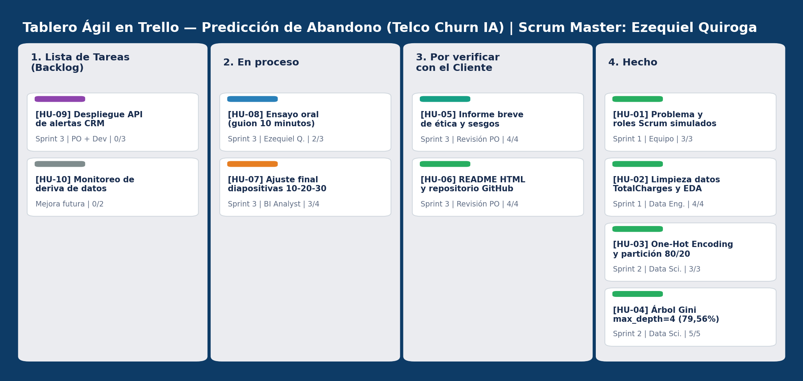
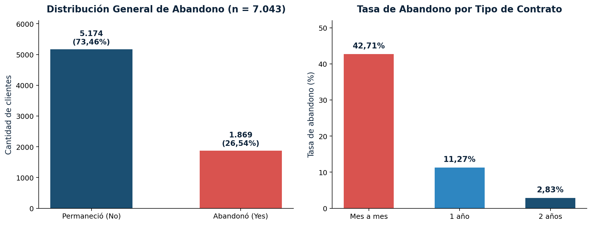
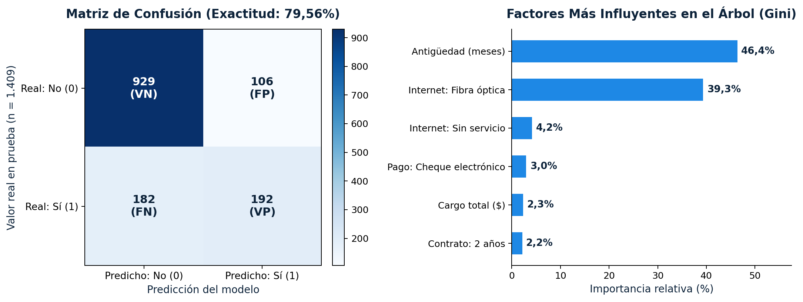

<div align="center">


# Proyecto Integrador Final — Simulación Profesional en Ciencia de Datos e IA
### Sistema Predictivo e Interpretable de Abandono de Clientes (*Telco Customer Churn*)

<p>
  <strong>Instituto Nuevos Aires (INA)</strong> · Tecnicatura Superior en Ciencia de Datos e Inteligencia Artificial<br>
  <strong>Asignatura:</strong> Prácticas Profesionalizantes I (Adentramiento al Campo Laboral) · <strong>Docente:</strong> MSc. Ángel Daniel Fuentes S.<br>
  <strong>Autor / Scrum Master:</strong> Ezequiel Quiroga · <strong>Fecha de Entrega:</strong> 24/11/2026
</p>

<p>
  
  
  
  
  
</p>

</div>

---

## 1. Resumen Ejecutivo

Este repositorio consolida la simulación completa de un proyecto profesional en el ámbito de **Ciencia de Datos e Inteligencia Artificial**, abarcando desde la definición estratégica y planificación ágil con **Scrum**, el seguimiento en **Trello** y el flujo colaborativo en **GitHub**, hasta el entrenamiento, auditoría ética y presentación ejecutiva de un modelo de **Árbol de Decisión (`DecisionTreeClassifier`)** que anticipa el abandono de clientes (*Customer Churn*).

> **Situación problema:** Sobre una cartera histórica de **7.043 clientes**, la operadora simulada *TelcoNova S.A.* registra una pérdida del **26,54 % (`1.869` bajas)**, alcanzando un crítico **`42,71 %`** de fuga en contratos mensuales (*Month-to-month*). El proyecto transforma una base cruda en alertas tempranas interpretables para acciones de retención.

---

## 2. Mapa del Proyecto (Alineado con los 4 Componentes Evaluados)

<table>
  <thead>
    <tr>
      <th>Componente de Evaluación</th>
      <th>Peso</th>
      <th>Entregables en este Repositorio</th>
    </tr>
  </thead>
  <tbody>
    <tr>
      <td><strong>A. Planificación del Proyecto</strong></td>
      <td><code>25 % (10 pts)</code></td>
      <td><a href="docs/A_PLANIFICACION_PROYECTO_SCRUM.md">docs/A_PLANIFICACION_PROYECTO_SCRUM.md</a> (Problema, 5 roles Scrum, Product Backlog de 10 HUs y 3 Sprints)</td>
    </tr>
    <tr>
      <td><strong>B. Ejecución y Herramientas</strong></td>
      <td><code>25 % (10 pts)</code></td>
      <td><a href="docs/B_TRELLO_Y_FLUJO_DE_TRABAJO.md">docs/B_TRELLO_Y_FLUJO_DE_TRABAJO.md</a>, <a href="docs/tablero_trello_importar.csv">tablero_trello_importar.csv</a>, flujo GitHub y código reproducible</td>
    </tr>
    <tr>
      <td><strong>C. Documentación Profesional</strong></td>
      <td><code>20 % (8 pts)</code></td>
      <td>Este <code>README.md</code> con HTML y <a href="docs/C_INFORME_ETICA_Y_RESPONSABILIDAD.md">docs/C_INFORME_ETICA_Y_RESPONSABILIDAD.md</a></td>
    </tr>
    <tr>
      <td><strong>D. Presentación Final (10-20-30)</strong></td>
      <td><code>30 % (12 pts)</code></td>
      <td><a href="presentacion/Presentacion_Final_Ezequiel_Quiroga_INA.pptx">Presentacion_Final_Ezequiel_Quiroga_INA.pptx</a> y <a href="docs/D_GUION_EXPOSICION_ORAL_10_MIN.md">guion oral de 10 min</a></td>
    </tr>
  </tbody>
</table>

---

## 3. Gestión Ágil: Equipo Simulado y Tablero Trello

- **Equipo simulado multifuncional:**
  - **Scrum Master & Líder Técnico de IA:** Ezequiel Quiroga *(facilitación, coordinación técnica, GitHub y exposición)*.
  - **Product Owner (PO):** Gerencia de Retención *(priorización por retorno e interpretabilidad)*.
  - **Data Engineer / DBA:** Limpieza de `TotalCharges`, anonimización de `customerID` y control de calidad de datos.
  - **Data Scientist / ML Engineer:** Codificación *One-Hot*, partición estratificada `80/20` y entrenamiento del modelo.
  - **BI & AI Ethics Analyst:** Visualización ejecutiva, auditoría de sesgos y documentación bajo normas académicas.

<div align="center">
  
</div>

---

## 4. Resultados Exploratorios y Rendimiento del Modelo

### Preparación Técnica Reproducible
1. **Limpieza:** Conversión numérica de `TotalCharges` corrigiendo **11 registros en blanco** (`tenure = 0`) imputados con `0`.
2. **Privacidad:** Exclusión del identificador `customerID`.
3. **Transformación:** Codificación *One-Hot* (`drop_first=True`) sobre 11 variables predictoras $\rightarrow$ **17 variables numéricas de entrada**.
4. **Evaluación honesta:** División estratificada `80/20` (**5.634 entrenamiento** / **1.409 prueba**, `random_state=42`) y modelo `DecisionTreeClassifier(criterion="gini", max_depth=4)`.

<div align="center">
  
</div>

<div align="center">
  
</div>

| Métrica Evaluada (`n = 1.409` prueba) | Valor Obtenido | Lectura para el Negocio |
| :--- | :---: | :--- |
| **Exactitud global (*Accuracy*)** | **79,56 %** | `1.121` predicciones correctas sobre `1.409` clientes nunca vistos. |
| **Verdaderos Negativos / Falsos Positivos** | `929 VN` / `106 FP` | Sensibilidad del `89,76 %` detectando clientes fieles. |
| **Verdaderos Positivos / Falsos Negativos** | `192 VP` / `182 FN` | Sensibilidad del `51,34 %` y precisión del `64,43 %` sobre la clase que abandona. |
| **Variables dominantes del árbol** | Antigüedad (`46,4 %`), Fibra óptica (`39,3 %`) | El riesgo se concentra en clientes recientes con contrato mes a mes (`42,71 %` de fuga). |

---

## 5. Síntesis del Informe de Ética y Seguridad

- **Privacidad (Ley N.º 25.326):** Eliminación de identificadores personales (`customerID`) y trabajo en modo lectura sobre copias históricas anonimizadas.
- **Sesgos y Desbalance (Enzo Ferrante, CONICET):** Se documenta explícitamente que el desbalance (`73,46 %` vs. `26,54 %`) origina `182` falsos negativos y se exige auditar variables sensibles (`SeniorCitizen`) antes de pasar a producción.
- **Transparencia y Control Humano (*Human-in-the-Loop*):** Se prioriza un árbol poco profundo (`max_depth=4`) auditable para asistir decisiones comerciales constructivas, nunca penalizaciones automáticas.
- **Seguridad del Código:** Cero secretos en el código fuente; configuración parametrizada mediante `.env.example` y protegida por `.gitignore`.

---

## 6. Estructura del Repositorio y Ejecución Local

```text
proyecto-integrador-final-churn-ia/
├── assets/                          # Logo oficial INA (azul/blanco) y gráficos en PNG
├── data/                            # Dataset Telco Customer Churn (7.043 filas)
├── docs/                            # Informes de los componentes A, B, C, D y CSV para Trello
├── notebooks/                       # Cuaderno base modelo_churn_telco.ipynb
├── presentacion/                    # Presentación PowerPoint final (regla 10-20-30)
├── src/                             # Script modular entrenar_y_evaluar.py
├── .env.example                     # Plantilla segura de variables de entorno
├── .gitignore                       # Exclusión de .env, entornos virtuales y temporales
├── requirements.txt                 # Dependencias del proyecto
└── README.md                        # Documentación principal del proyecto
```

### Cómo reproducir los resultados y regenerar los gráficos

```bash
# 0. Clonar el repositorio y entrar en la carpeta
git clone https://github.com/eze2307/proyecto-integrador-final-churn-ia.git
cd proyecto-integrador-final-churn-ia

# 1. Crear y activar entorno virtual (Windows PowerShell)
python -m venv .venv
.venv\Scripts\Activate.ps1

# 2. Instalar dependencias
pip install -r requirements.txt

# 3. Configurar parámetros opcionales sin exponer claves
copy .env.example .env

# 4. Entrenar el modelo, imprimir métricas y regenerar gráficos en assets/
python src/entrenar_y_evaluar.py
```

---

<div align="center">
  <sub>Trabajo académico desarrollado para la Tecnicatura Superior en Ciencia de Datos e IA — Instituto Nuevos Aires (INA), Noviembre de 2026.</sub>
</div>
