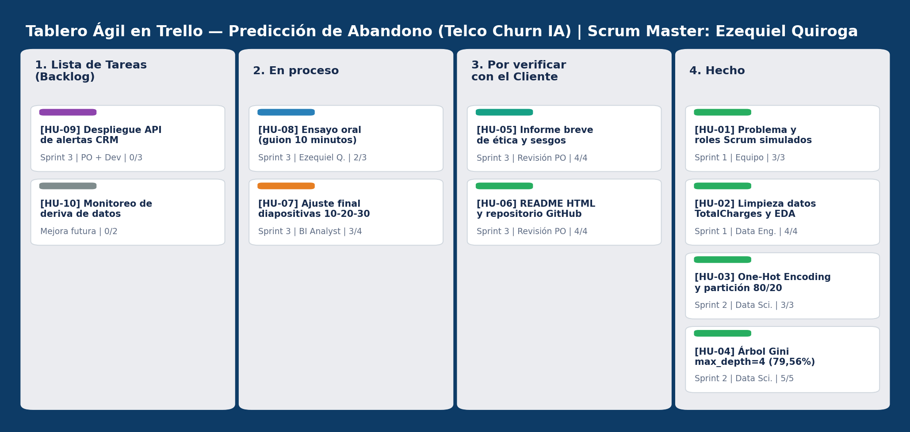

# Componente B — Ejecución en Trello, Flujo de Trabajo y Artefactos Scrum

> **Proyecto Integrador Final — Prácticas Profesionalizantes I (Instituto Nuevos Aires — INA)**  
> **Alumno:** Ezequiel Quiroga | **Peso en rúbrica:** `25 %` (`10 pts`)

---

## 1. Gestión Visual en Trello (4 Columnas de Trabajo)

Siguiendo la estructura enseñada en la **Clase 8**, el tablero ágil del proyecto (*«Telco Churn IA — Proyecto Integrador Final»*) organiza el flujo en **4 columnas**:

1. **Lista de Tareas (Backlog):** Historias de usuario futuras o mejoras evolutivas pendientes de priorización en próximos ciclos (`HU-09`, `HU-10`).
2. **En proceso:** Tareas actualmente activas en el tramo final del Sprint 3 (`HU-07`, `HU-08`).
3. **Por verificar con el Cliente:** Incrementos terminados técnicamente que requieren validación del *Product Owner* antes de pasar a cierre (`HU-05`, `HU-06`).
4. **Hecho:** Tareas completas, probadas y aprobadas en la *Sprint Review* de los Sprints 1 y 2 (`HU-01`, `HU-02`, `HU-03`, `HU-04`).

> **Nota práctica:** En esta carpeta también se incluye el archivo [tablero_trello_importar.csv](tablero_trello_importar.csv) con todas las tarjetas, listas, etiquetas, fechas límite y checklists listas para importar o copiar directamente a tu tablero real de Trello.

---

## 2. Flujo de Trabajo en Git y GitHub (Buenas Prácticas)

Para trabajar de forma ordenada y segura en equipo, el proyecto adopta el siguiente flujo de control de versiones:

### Estructura de Ramas (*Branching Strategy*)
- `main`: Rama estable lista para presentar y evaluar. **No se realizan cambios directos sin revisión.**
- `feature/datos-eda`: Limpieza de `TotalCharges`, anonimización y generación de `01_distribucion_churn.png`.
- `feature/modelo-arbol`: Implementación de `src/entrenar_y_evaluar.py` y validación de métricas (`Accuracy = 79,56 %`).
- `feature/docs-etica-presentacion`: Redacción de `README.md` HTML, informes de ética/Scrum y presentación final.

### Convención de Commits y Pull Requests
1. Antes de iniciar cualquier jornada en local: `git pull origin main`.
2. Trabajo en rama dedicada con mensajes claros (*Conventional Commits*):
   - `feat(data): limpiar TotalCharges y excluir customerID`
   - `feat(model): entrenar DecisionTreeClassifier max_depth=4`
   - `docs(ethics): agregar informe de sesgos y privacidad`
3. Revisión cruzada mediante **Pull Request** verificando que las figuras se regeneren sin errores y que no exista ningún secreto en el código.

### Seguridad de Credenciales y Datos
- Uso obligatorio de `.gitignore` para excluir entornos virtuales (`.venv/`), archivos temporales (`__pycache__/`) y configuraciones locales (`.env`).
- Plantilla `.env.example` para parametrizar rutas, semilla aleatoria (`RANDOM_SEED=42`) y profundidad del modelo (`MODEL_MAX_DEPTH=4`) sin exponer datos ni credenciales reales.
- **Regla de oro operativa (Clase 8):** Nunca ejecutar operaciones de escritura (`INSERT`, `UPDATE`, `DELETE`) sobre bases de datos productivas sin orden formal por escrito/ticket; este análisis trabaja exclusivamente sobre una exportación histórica anonimizada en modo lectura.

---

## 3. Artefactos y Minutas Simuladas de Ceremonias Scrum

### Acta 1 — *Sprint Planning* (Inicio Sprint 1 y 2)
- **Participantes:** Ezequiel Quiroga (*Scrum Master*), Product Owner, Data Engineer, Data Scientist, BI & Ethics Analyst.
- **Acuerdos:**
  - Se define trabajar sobre el dataset histórico anonimizado de `7.043` clientes (`WA_Fn-UseC_-Telco-Customer-Churn.csv`).
  - El PO prioriza la **explicabilidad** del modelo por encima de algoritmos complejos tipo «caja negra», estableciendo un Árbol de Decisión con `max_depth=4`.
  - Se fijan `15 Story Points` totales para los dos primeros Sprints técnicos y `13 Story Points` para el Sprint 3 de documentación, ética y presentación.

### Acta 2 — *Daily Scrum* (Muestra representativa — Mitad del Sprint 2)
- **Data Engineer:** *«Ayer validé la conversión numérica de `TotalCharges`; confirmamos 11 casos con `tenure = 0` e imputamos `0`. Hoy apoyo en la revisión de columnas dummy. Sin bloqueos.»*
- **Data Scientist:** *«Ayer dejé lista la partición estratificada `80/20` (`5.634 / 1.409`). Hoy entreno el Árbol Gini con `max_depth=4` y reviso la matriz de confusión. Sin bloqueos.»*
- **Scrum Master (Ezequiel Quiroga):** *«Hoy coordino la integración del script `src/entrenar_y_evaluar.py` en la rama principal y actualizo el tablero Trello junto con el archivo `.env.example`.»*

### Acta 3 — *Sprint Review* (Cierre Técnico — Fin del Sprint 2)
- **Incremento demostrado ante el PO:**
  - Exactitud del modelo en datos de prueba nunca vistos: **`79,56 %`** (`1.121` aciertos de `1.409`).
  - Se detectan `192` abandonos reales anticipados correctamente (**Verdaderos Positivos**), aunque `182` abandonos no fueron capturados (**Falsos Negativos**).
  - Principales señales identificadas por el modelo: antigüedad (`tenure`, `46,4 %`), internet por fibra óptica (`39,3 %`), ausencia de servicio de internet (`4,2 %`) y pago con cheque electrónico (`3,0 %`).
- **Resolución del PO:** Se aprueba el incremento técnico y se solicita auditar específicamente el impacto de los `182` falsos negativos y posibles sesgos antes de la entrega final.

### Acta 4 — *Sprint Retrospective* (Mejora Continua del Equipo)
- **Qué funcionó bien:** Reutilizar la base técnica validada (`TP2`) aceleró la entrega; trabajar con `random_state=42` y división estratificada aseguró reproducibilidad exacta entre compañeros.
- **Qué mejorar:** Documentar desde el primer día los supuestos de imputación de datos y automatizar la exportación de gráficos a `assets/` para evitar capturas manuales desactualizadas.
- **Acción comprometida para Sprint 3:** Consolidar un único comando (`python src/entrenar_y_evaluar.py`) capaz de verificar métricas y regenerar todas las figuras antes de construir la presentación ejecutiva.
